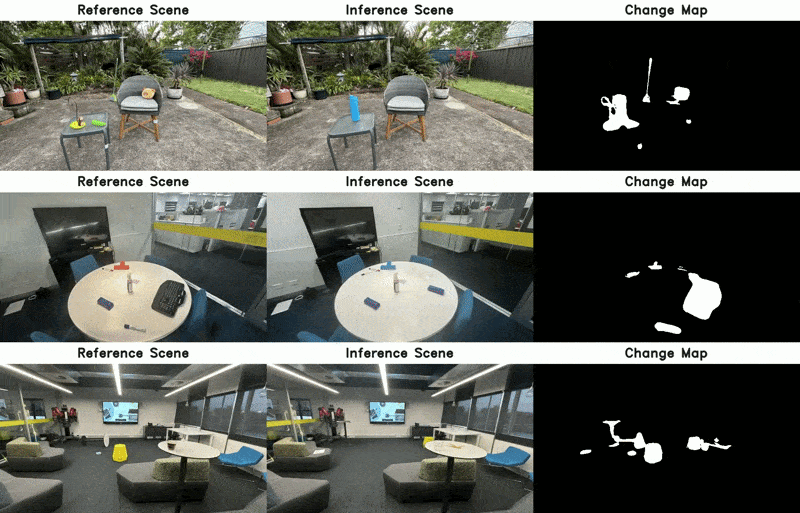

<p align="center">
  
</p>

<h1 align="center">O-SCD: Online Scene Change Detection</h1>

<p align="center">
  Detecting what has changed in a mapped scene while the agent is still on site:<br>
  online, pose-agnostic, label-free and multi-view consistent.
</p>

<p align="center">
  <a href="https://chumsy0725.github.io/O-SCD/"></a>
  <a href="https://arxiv.org/abs/2511.12370"></a>
  <a href="https://huggingface.co/datasets/ChamudithaJay/PASLCD"></a>
</p>

<p align="center">
  
</p>

This repository hosts the O-SCD line of work on online scene change detection. Each method lives in its own self-contained directory, with its own environment, dependencies and scripts.

## News

- **2026**: O-SCD is accepted to **CVPR 2026** as a **Highlight**.
- **Coming soon**: O-SCD++ paper and code.

## Methods

| Method | Paper | Venue | Links | Code |
|---|---|---|---|---|
| **O-SCD** | Changes in Real Time: Online Scene Change Detection with Multi-View Fusion | CVPR 2026 (Highlight) | [Project page](https://chumsy0725.github.io/O-SCD/) · [Paper](https://openaccess.thecvf.com/content/CVPR2026/html/Galappaththige_Changes_in_Real_Time_Online_Scene_Change_Detection_with_Multi-View_CVPR_2026_paper.html) · [arXiv](https://arxiv.org/abs/2511.12370) | [`O-SCD/`](O-SCD) |
| **O-SCD++** | Coming soon | – | [Project page](https://chumsy0725.github.io/O-SCD/plusplus/) | [`O-SCD++/`](O-SCD%2B%2B) |

## Repository layout

```
O-SCD/       CVPR 2026 code
O-SCD++/     coming soon
docs/        project website
```

## Getting started

Each method is installed and run from inside its own directory. For O-SCD:

```shell
git clone https://github.com/Chumsy0725/O-SCD.git
cd O-SCD/O-SCD
```

then follow [`O-SCD/README.md`](O-SCD/README.md).

## Dataset

All methods are evaluated on **PASLCD**, available on [HuggingFace](https://huggingface.co/datasets/ChamudithaJay/PASLCD).

## Related work

- [MV3DCD](https://chumsy0725.github.io/MV-3DCD/): Multi-View Pose-Agnostic Change Localization with Zero Labels (CVPR 2025)
- [GS-Diff](https://chumsy0725.github.io/GS-DIFF/): From Pixels to Primitives: Scene Change Detection in 3D Gaussian Splatting

## Citation

If you find this work useful, please cite:

```bibtex
@inproceedings{galappaththige2026online,
  title     = {Changes in Real Time: Online Scene Change Detection with Multi-View Fusion},
  author    = {Galappaththige, Chamuditha Jayanga and Lai, Jason and Windrim, Lloyd and Dansereau, Donald and Suenderhauf, Niko and Miller, Dimity},
  booktitle = {Proceedings of the IEEE/CVF Conference on Computer Vision and Pattern Recognition (CVPR)},
  pages     = {32246--32256},
  year      = {2026}
}
```
## License

This code is released for non-commercial academic research and evaluation only. Third-party components retain their own licenses.

### Acknowledgement

Our code is based on [3D Gaussian Splatting](https://github.com/graphdeco-inria/gaussian-splatting), [on-the-fly-nvs](https://github.com/graphdeco-inria/on-the-fly-nvs), [FastGS](https://github.com/fastgs/FastGS) and [SAMv2](https://github.com/facebookresearch/sam2). We sincerely thank the authors for open-sourcing their codebase.

### Funding Acknowledgement

This work was supported by the ARC Research Hub in Intelligent Robotic Systems for Real-Time Asset Management (ARIAM) (IH210100030) and Abyss Solutions. C.J., N.S., and D.M. also acknowledge ongoing support from the QUT Centre for Robotics.
